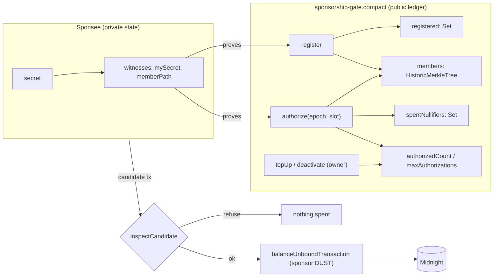

# Sponsorship Gate

Anonymous, rate-limited fee sponsorship for Midnight. A sponsor funds a pool; members prove membership in zero knowledge and draw a bounded number of sponsored actions per epoch. No one, including the sponsor, can link a request to a person or to that person's other requests.

> **Wave 2 in one paragraph.** We found a privacy leak in our own Wave 1 contract (`authorize` published the caller's commitment in the public transcript), fixed it with a Merkle-membership proof, and proved the fix three ways: a transcript-level regression test, a control run on the preserved Wave 1 contract that *does* leak, and a byte-level check of real transactions on a devnet. We also shipped what Wave 1 only specified: a real two-party flow where an **unfunded** wallet's transactions are fee-balanced by a sponsor after it inspects them, and a web console that runs the real compiled circuits in the browser so you can try it with no wallet and no Docker.

| | |
|---|---|
| **Try it now** | `cd app && npm install && npm run dev`, or the GitHub Pages build (see [Deploying the console](#deploying-the-console)). Click **Run the guided demo**. |
| **Tests** | 34 contract tests · 24 sponsor-inspector tests · 12 browser end-to-end checks |
| **Real devnet evidence** | [`integration/evidence-local.json`](integration/evidence-local.json): deploy + 3 sponsored transactions, with blocks, tx ids, fees |
| **Pitch deck** | [`submission/Sponsorship-Gate-Wave2-Pitch-Deck.pptx`](submission/Sponsorship-Gate-Wave2-Pitch-Deck.pptx) |
| **License** | Apache-2.0 ([`LICENSE`](LICENSE)) |

---

## Contents

1. [The problem](#the-problem)
2. [What changed since Wave 1](#what-changed-since-wave-1)
3. [How to evaluate this submission](#how-to-evaluate-this-submission)
4. [The privacy finding](#the-privacy-finding)
5. [Architecture and Midnight integration](#architecture-and-midnight-integration)
6. [The sponsor-side inspector](#the-sponsor-side-inspector)
7. [Evidence, by tier](#evidence-by-tier)
8. [Security model and limitations](#security-model-and-limitations)
9. [Repository structure](#repository-structure)
10. [Deploying the console](#deploying-the-console)
11. [Roadmap](#roadmap)

---

## The problem

A new user has no funds, so someone else must pay their first fee. On a transparent chain that payment is a permanent public record of who funded whom. Ethereum's ERC-4337 paymasters make sponsorship possible, but `paymasterAndData` is public forever, and the community is retrofitting privacy after the fact (a draft privacy-paymaster ERC; a TEE-based design).

Sponsorship needs three properties at once, and they pull against each other:

* **Privacy.** The sponsor should not learn who they sponsored, and nobody should be able to group one person's requests.
* **Abuse resistance.** Anonymous and free is an open drain. Each identity must cost something; each request must be bounded.
* **Sponsor safety.** The sponsor pays real fees, so it must only ever pay for exactly the call it agreed to.

Neither proof-of-work-as-Sybil-cost (Dwork-Naor, 1992) nor epoch-scoped nullifier rate limiting (the shape of RLN) is new cryptography, and we claim no novelty there. The contribution is the composition, where it sits in Midnight's stack, and the discipline of testing the privacy claim at the level it is actually made.

## What changed since Wave 1

| Area | Wave 1 | Wave 2 |
|---|---|---|
| **Privacy of `authorize`** | Leaked the member's commitment in the public transcript (not caught by any Wave 1 test) | Merkle-membership proof; only a root is disclosed. Transcript-level regression tests + a control contract that demonstrates the Wave 1 leak |
| **Rate limiting** | One authorization per member per epoch | `authorize(epoch, slot)`: a configurable quota of independent single-use slots per epoch |
| **Sponsor budget** | Off-chain accounting only | On-chain `maxAuthorizations` ceiling + counter, owner `topUp` (increase-only) |
| **Deployment** | Never completed | Deployed and exercised on a local devnet; root cause of Wave 1's hang found and fixed (see [below](#why-wave-1-never-deployed)) |
| **Two-party sponsorship** | Specified in prose | Running code: an unfunded sponsee's transactions, balanced and submitted by the sponsor |
| **Sponsor-side check** | An interface comment | `inspectCandidate`: 7 refusal classes (incl. a minimum-anonymity-set policy), 24 unit tests, exercised against a real `ContractDeploy` |
| **Frontend** | None | Web console running the real compiled circuits in-browser (sponsor / member / observer / attack lab / on-chain evidence) |
| **Tests** | 16 simulated | 34 contract + 24 inspector + 12 browser e2e, plus a real-devnet run with abuse attempts |
| **Licensing** | README referenced a missing `LICENSE` | `LICENSE` (Apache-2.0) added |

## How to evaluate this submission

Three levels, from no setup to full setup. Each is independent.

### 1. The console (no wallet, no Docker, no server)

```bash
cd app
npm install
npm run dev          # http://localhost:5173
```

* **Overview → Run the guided demo.** Deploys a pool, registers three members, authorizes each, and drops you on the Observer tab.
* **Observer → Linkability lab.** The same member, the same flow, run on the Wave 1 contract and the Wave 2 contract. The Wave 1 transcript contains the member's commitment (highlighted); the Wave 2 transcript does not.
* **Attack lab → Run all.** Ten attacks on fresh pools (replay, outsider, over-quota, skipped PoW, double registration, future epoch, budget drain, non-owner `topUp`, lowering the budget, using a closed pool). A pass means the circuit *refused*: no proof exists, so no transaction would be made.
* **Sponsor → Run all candidates.** The sponsor's inspector verdict on nine candidate transactions, plus a replay built from a real spent nullifier in the live pool. Also here: the **anonymity-set meter** with an adjustable minimum-pool-size policy, and a **runway calculator** using the fee measured on the devnet.
* **Observer → membership tree.** An animated Merkle tree; **Reveal private path** shows what stays hidden (your path) versus what is disclosed (only the root). Hashes are click-to-copy, and the public ledger view downloads as JSON.
* **Anywhere:** an activity timeline of every event, a light/dark toggle, and keyboard shortcuts (press <kbd>?</kbd>).
* **On-chain.** The devnet evidence.

Everything the sandbox does is executed by the compiled `sponsorship-gate.compact` circuits (the same generated module the contract tests run), not by a re-implementation.

### 2. The tests (needs the [Compact toolchain](https://docs.midnight.network/getting-started/installation) and Node 24)

```bash
cd contract
npm install
npm run compact           # compile (skips ZK key generation)
npm run compact:control   # compile the preserved Wave 1 contract (for the leak control test)
npm test                  # 34 tests

cd ../integration
npm test                  # 24 sponsor-inspector tests, no install needed

cd ../app
npm run build && npm run preview &
CHROME_PATH=/path/to/chrome npm run e2e     # 12 browser checks
```

### 3. The real devnet flow (needs Docker; ~5 minutes)

```bash
docker compose -f infra/devnet/standalone.yml --env-file infra/devnet/standalone.env up -d

cd integration
npm install
npm run compact           # compiles with 0.31.1 *with* proving keys (what midnight-js 4.1.1 expects)
npm run flow              # writes integration/evidence-local.json
```

`npm run flow`, in order:

1. Builds a funded **sponsor** wallet and deploys the pool (quota 2, budget 5).
2. Creates a **sponsee** with no NIGHT, no DUST, and no wallet. It mines the proof-of-work, builds and proves `register`, then `authorize` for slots 0 and 1. For each, the wallet provider hands the candidate to the sponsor, which runs `inspectCandidate`, balances with its own DUST, and submits.
3. **Abuse attempts against the real chain:** a third authorization (quota), a replay, a sponsee asking the sponsor to pay for an unrelated contract *deployment*, and a registration through a sponsor with no DUST.
4. **A byte-level privacy check:** searches each submitted transaction's actual bytes for the sponsee's commitment. `register` must contain it (the positive control: the method can see it) and `authorize` must not.

The last committed run's output is in `integration/evidence-local.json` and rendered on the console's **On-chain** tab.

## The privacy finding

Wave 1's `authorize` checked membership with `registered.member(commitment)`. The compiler accepted it, because the commitment is a hash and not raw witness data, so `disclose()` is not required. But a ledger **query** is not free of public effects: its argument is written into the call's **public transcript**. Reading the generated code confirms it: `_authorize_0` pushes the commitment with `storage: false` and then runs `member`, and that push is part of the transcript every node and indexer sees.

Consequence: every `authorize` call published the caller's commitment, so anyone could group all of one member's requests and tie them to their registration. This is exactly the linkability the design claims to prevent.

Wave 1's 16 tests passed because they assert on *ledger state*, and a query changes no state. The finding is a reminder that for a privacy claim, the transcript is the artifact to test.

**The fix.** `members` is a `HistoricMerkleTree<10, Bytes<32>>`. `authorize` takes the member's Merkle path from a witness, hashes it to a root inside the circuit, asserts `path.leaf == commitment`, and discloses **only the root**. A plain `Set` remains solely for `register`'s duplicate check, where the commitment is public anyway.

**How we know the test can fail** ([`contract/src/test/privacy.test.ts`](contract/src/test/privacy.test.ts), [`privacy-control.test.ts`](contract/src/test/privacy-control.test.ts)):

* `register`'s transcript *does* contain the commitment (sanity: the detector can see commitments at all).
* Wave 2 `authorize`'s transcript does not contain the commitment or the secret.
* The identical check against the preserved Wave 1 contract ([`contract/control/sponsorship-gate-v1.compact`](contract/control/sponsorship-gate-v1.compact)) *finds* the commitment. If it didn't, the Wave 2 assertion would prove nothing.
* On the devnet, the same byte search over the real submitted transactions: found in `register`, absent from both `authorize` calls.

## Architecture and Midnight integration



### Dual-ledger model

| Public ledger (on-chain) | Private state (off-chain, never published) |
|---|---|
| Pool config (`poolId`, epoch length, PoW target, owner key, quota) | The member's secret |
| Registered commitments, Merkle tree + roots | The member's Merkle path |
| Spent nullifiers | The owner's secret |
| `authorizedCount`, `maxAuthorizations`, `active` | PoW nonce |

### Circuits

| Circuit | Who | What it enforces |
|---|---|---|
| `register(nonce)` | member | pool active; `H(pow‖secret‖nonce)` 24-bit prefix `<` target; commitment not already registered; inserts into the Set and the tree |
| `authorize(epoch, slot)` | member | pool active; `slot < quota`; `authorizedCount < maxAuthorizations`; epoch matches block time; Merkle membership (root disclosed only); nullifier `H(pool, epoch, slot, secret)` unspent; spends it; increments the counter |
| `topUp(newMax)` | owner | owner secret; `newMax > maxAuthorizations` (increase-only) |
| `deactivate()` | owner | owner secret; closes the pool |
| `checkPow`, `derivedOwnerKey`, `commitmentOf` | pure, exported | client-side helpers that share the contract's exact hashing, so a nonce accepted off-chain is accepted on-chain |

### Midnight primitives used

* `HistoricMerkleTree`, `merkleTreePathRoot`, `checkRoot`: zero-knowledge membership with recent roots kept valid.
* `persistentCommit` / `persistentHash` with explicit domain separation.
* `Set`, `Counter` ledger types; `blockTimeGte` / `blockTimeLt` for epoch windows.
* `disclose()` information-flow tracking, used deliberately: the only disclosed values in `authorize` are the Merkle root and the nullifier.
* **DUST** as a shielded, non-transferable fee resource separate from NIGHT, which is what lets a third party pay without the payment being a field every observer reads.
* **Third-party balancing**: `WalletFacade.balanceUnboundTransaction` with the sponsor's keys, on a transaction the sponsor did not build.

The contract deliberately does **not** read or move DUST. It enforces a budget the sponsor commits to on-chain; the DUST itself is a wallet-layer concern.

## The sponsor-side inspector

`authorize` commits to `(pool, epoch, slot, secret)` and nothing about the transaction it travels in. A nullifier therefore proves nothing about the *candidate* a sponsor is about to pay for. Wave 1's review identified this and only specified a check; Wave 2 implements it ([`integration/src/lib/sponsor-inspector.ts`](integration/src/lib/sponsor-inspector.ts)).

| Code | Refuses |
|---|---|
| `NOT_A_CALL` | A smuggled contract deployment or maintenance update (**exercised against a real `ContractDeploy` on the devnet**) |
| `TOO_MANY_ACTIONS` | A bundle of calls, to inflate the sponsored fee |
| `WRONG_CONTRACT` | A valid-looking call to some other contract |
| `ENTRY_POINT_NOT_SPONSORED` | `topUp` / `deactivate`: owner-only, never something a sponsor pays a stranger for |
| `HAS_ZSWAP_MOVEMENT` | A candidate that also moves shielded value: a sponsor pays fees, not transfers |
| `NULLIFIER_ALREADY_SPENT` | A replay that would fail on-chain *after* the sponsor had paid |
| `ANONYMITY_SET_TOO_SMALL` | (Optional policy) `authorize` while the pool has fewer members than the sponsor's minimum. `register` stays sponsored so the pool can grow |

The file has no Node or browser dependencies, so the **same function** runs in the devnet sponsor service, the unit tests, and the web console. Midnight's contract-communications commitment then prevents the payload being swapped after the check.

## Evidence, by tier

Terms are used precisely. Nothing is claimed at a higher tier than it has reached.

* **SIMULATED**: executed against the compiled circuit with no network (`--skip-zk`).
* **LOCAL**: executed against a real local node, indexer and proof server.
* **LIVE**: executed against a public network (Preprod / mainnet).

| Tier | Evidence |
|---|---|
| **SIMULATED** | 34 contract tests: the 16 Wave 1 invariants (re-passing on the new contract), 13 feature/membership tests (quota, budget, `topUp`, historic roots, outsiders, cross-pool), 4 transcript-privacy tests, 1 Wave 1 control. 24 inspector unit tests. 12 browser end-to-end checks in headless Chrome. |
| **LOCAL** | A real pool deployment and 3 sponsored transactions (register + 2 authorize) by an unfunded sponsee, paid by the sponsor, with real proofs; abuse attempts refused (quota, replay, smuggled deploy, sponsor with no DUST); byte-level privacy check over the real transactions. Ids in `integration/evidence-local.json`. |
| **LIVE** | **None yet.** No Preprod or mainnet deployment. `TARGET=preprod npm run flow` runs the same script given a funded Preprod wallet in `integration/.preprod-seed` (git-ignored). |

### Why Wave 1 never deployed

Wave 1's deployment attempt reached "proof generated, transaction balanced, submitted" and then hung with no error and no block. The cause was a **version mismatch**, found by comparing against a working reference stack: the containers in use were node 1.0.0 / indexer 4.3.3 / proof-server 8.1.0, newer than the ledger the stable SDK line (midnight-js 4.1.1, ledger-v8 8.1.2, wallet-sdk-facade 4.1.0) speaks, and the node dropped the transactions silently. The set that line was validated against is node **0.22.3** + indexer **4.0.0**. [`infra/devnet/standalone.yml`](infra/devnet/standalone.yml) pins it, with the reason beside it.

## Security model and limitations

* **Anonymity set = the pool's size.** The disclosed root identifies a snapshot, so a member is hidden among those registered at that snapshot. A one-member pool hides nothing. Pool operators should publish a minimum size before sponsoring.
* **Sybil resistance is bounded by proof-of-work, not by identity.** It raises the cost of minting identities; it does not eliminate them. The on-chain budget bounds the sponsor's total exposure regardless.
* **The contract cannot see DUST.** `maxAuthorizations` is a commitment the sponsor makes, not a read of their balance.
* **`registered` and `spentNullifiers` grow without bound.** An epoch-partitioned scheme is Wave 3 work.
* **Merkle tree depth is 10 (1,024 members).** Pools that expect more need a larger tree; this is a compile-time constant.
* **Owner authorization is a hash commitment, not a signature scheme.** Acceptable for a single owner key; not for delegated administration.
* **The nullifier is unlinkable to the commitment, but timing is not hidden.** A pool with one request per day tells an observer when that request happened.
* **The sandbox is a sandbox.** It runs the real circuits against an in-memory ledger. The on-chain evidence is the devnet run, not the browser.
* **No external audit.** The privacy finding above came from our own review; a third-party review is on the roadmap.

## Repository structure

```text
contract/
  src/sponsorship-gate.compact     the pool contract
  src/witnesses.ts                 mySecret + memberPath witnesses (memberPath reads the public tree)
  src/pow.ts                       PoW mining helper
  src/test/                        simulator, 34 tests, transcript helpers
  control/sponsorship-gate-v1.compact   the Wave 1 contract, preserved verbatim as a leak control

integration/
  src/sponsored-flow.ts            the real two-party devnet flow (+ abuse attempts, privacy check)
  src/lib/sponsor-inspector.ts     the inspector (dependency-free; shared with the console)
  src/lib/chain.ts                 wallet / network wiring
  src/test/inspector.test.ts       24 unit tests
  evidence-local.json              output of the last devnet run
  src/deploy-and-call.ts           Wave 1's single-party probe; targets the Wave 1 contract, kept for history

app/                               web console (Vite + TypeScript, no framework)
  src/engine.ts                    runs the compiled circuits in the browser
  src/generated/                   compiled JS modules (v2 = this wave, v1 = control); `npm run sync-contract`
  e2e/console.e2e.mjs              browser end-to-end test

infra/devnet/standalone.yml        version-pinned node + indexer + proof server
submission/                        decks, build scripts, milestone notes
```

## Deploying the console

`.github/workflows/pages.yml` runs the inspector tests, builds `app/`, and publishes it to GitHub Pages on every push to `main` that touches the app. In the repository settings, set **Pages → Source** to **GitHub Actions**. The build uses relative asset paths, so it works under any repository path. The compiled contract modules are committed under `app/src/generated/`, so the build needs no Compact toolchain.

To refresh them after changing the contract: `npm run compact && npm run compact:control` in `contract/`, then `npm run sync-contract` in `app/`.

## Roadmap

**Wave 3**

* Preprod deployment with the same `npm run flow`, and a funded wallet.
* Enforce the minimum-anonymity-set policy in a long-running sponsor service (the inspector option and console control exist).
* A reference sponsor *service* (long-running, per-pool budgets, rate limits) built around `inspectCandidate`.
* Epoch-partitioned nullifiers so the spent set stops growing without bound.
* A browser wallet (DApp connector) so the console can drive a live pool, not only the sandbox.
* An independent review of the contract and the inspector.

## License

Apache License 2.0. See [`LICENSE`](LICENSE).

SPDX-License-Identifier: Apache-2.0
